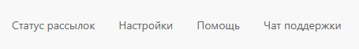

# Описание панели приложения

Панель приложения Олчат WABA является главным интерфейсом, содержащим набор инструментов для управления настройками приложения, получения актуальной информации о подключенных линиях и статусах подключения.

<figure><figcaption></figcaption></figure>

## Меню приложения

<figure><figcaption></figcaption></figure>

* Пункт меню **«Статус рассылок».** Открывает страницу просмотра статусов рассылок CRM-маркетинга. Подробнее [в статье](https://waba.docs.olchat.io/vozmozhnosti/rassylka-shablonov-s-pomoshyu-marketinga#status-rassylok-marketinga).
* Пункт меню **«Настройки».** Подробнее в статье [opisanie-nastroek-prilozheniya.md](opisanie-nastroek-prilozheniya.md "mention")
* Пункт меню **«Помощь».** Ссылка на данную документацию
* Пункт меню **«Чат поддержки».** Открывает чат поддержки пользователей приложения Олчат WABA в вашем Битрикс24

## Список коннекторов

Содержит список подключенных коннекторов с информацией о подключении и возможностью перейти к настройкам коннектора, открытой линии, а также кнопку для подключения новых коннекторов.

Подробнее о настройках коннектора в статье [opisanie-nastroek-konnektora.md](opisanie-nastroek-konnektora.md "mention").

Подробнее о подключении коннектора в статье [podklyuchenie-konnektora.md](../podklyuchenie-konnektora.md "mention").

Подробнее о настройке открытой линии в статье [nastroika-otkrytoi-linii.md](../nastroika-otkrytoi-linii.md "mention").
